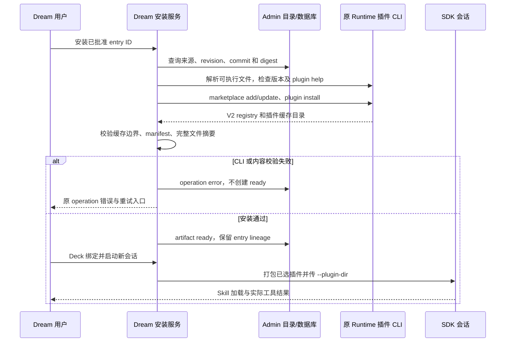
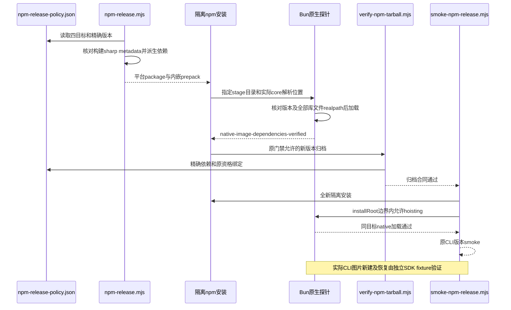
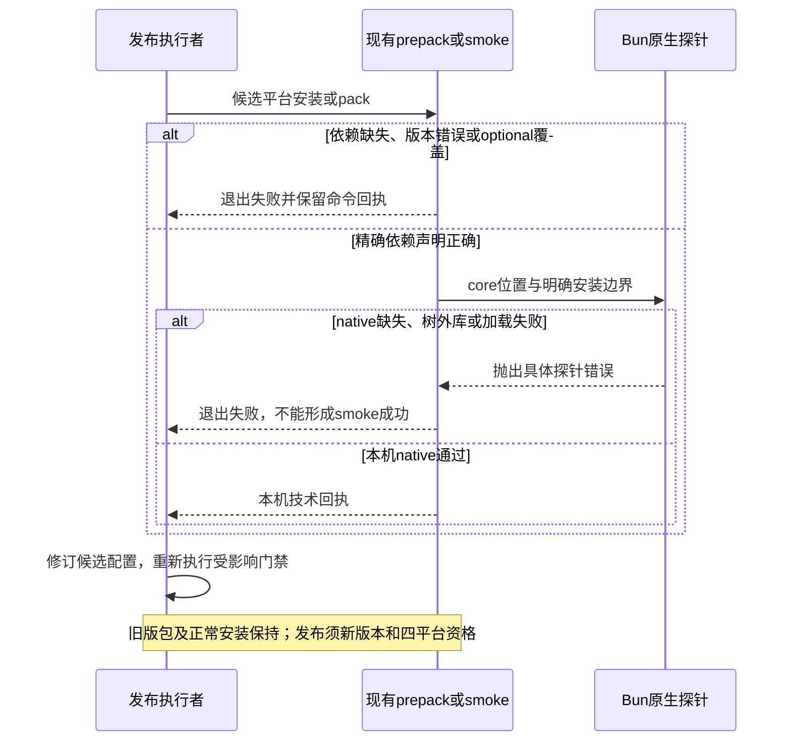
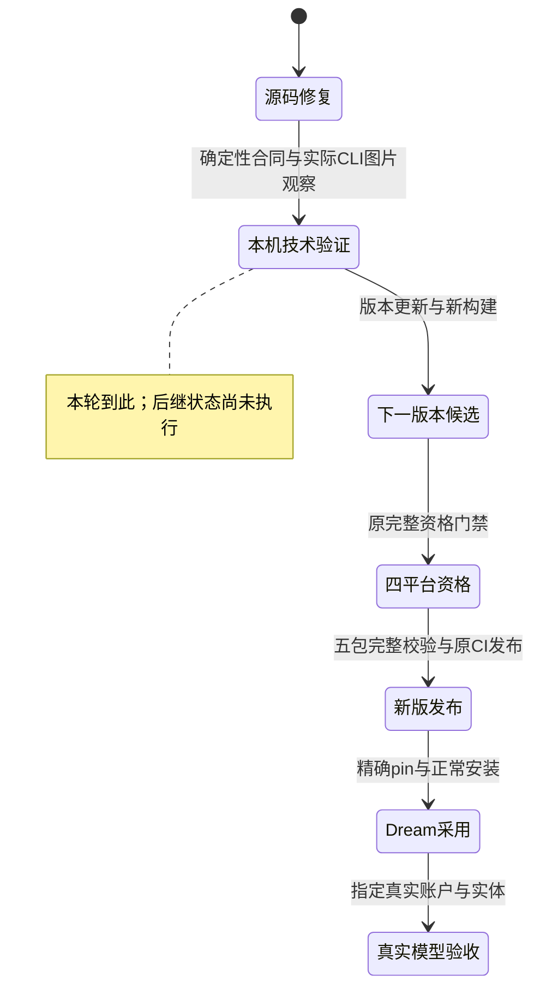
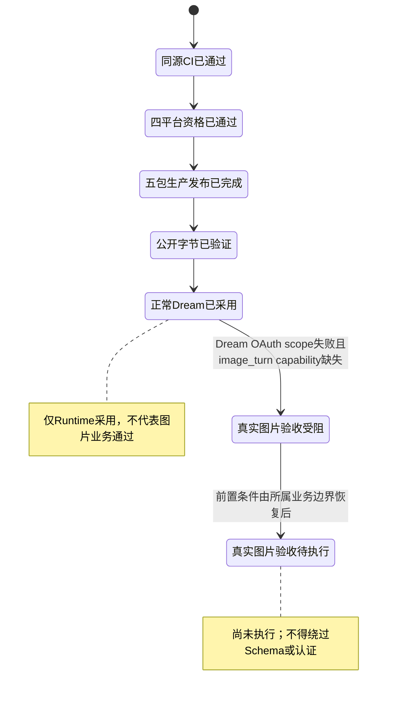
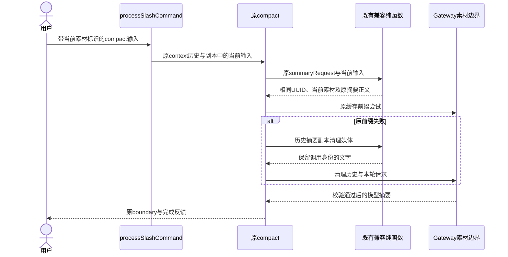
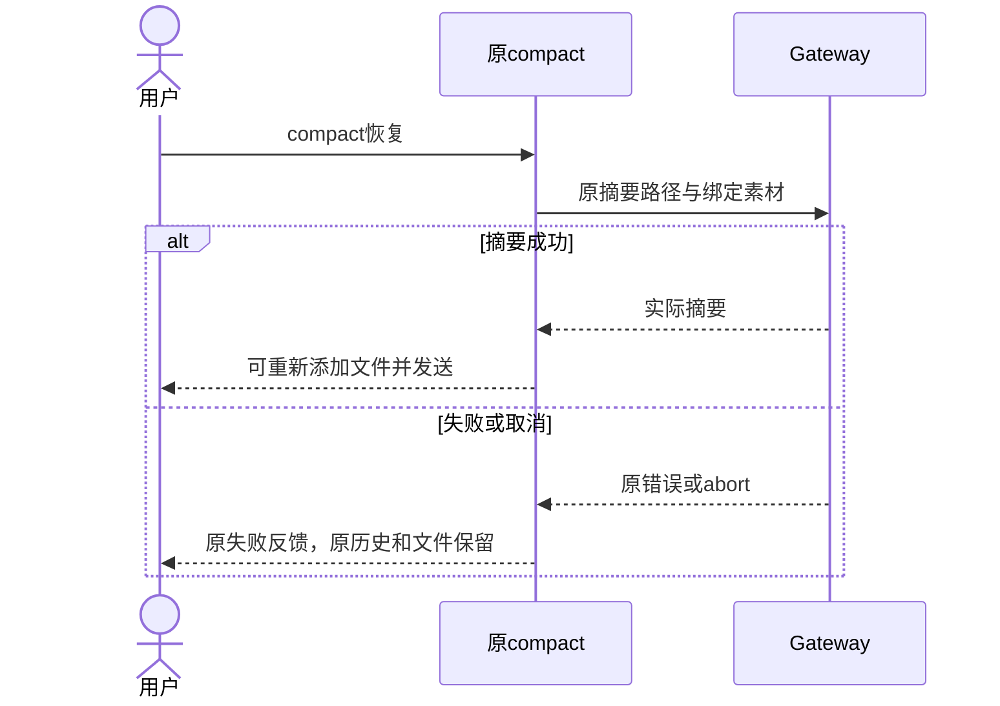
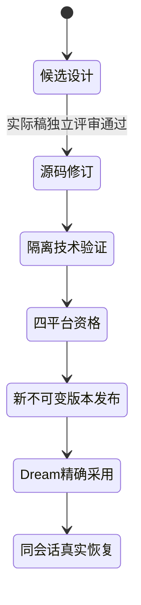

<!-- [Input] Original module recovery, duplicate source directory, GitHub npm publishing and local Dream integration. -->
<!-- [Output] Minimal implementation and interaction plan with independently verifiable release states. -->
<!-- [Pos] Current source-cleanup/release/adoption design and acceptance checklist. -->
<!-- [Sync] 2026-10-11: distinguish Dream OAuth scope failure from Admin operator rejection; published Runtime/adoption and schema readiness remain separate. -->
<!-- [Sync] 2026-09-13: retain completed immutable release; scope post-release visibility/documentation fixes without redesign. -->

# 唯一源码、CI 发布与本机 Dream 更新

<!-- [Sync] 2026-09-15: restore original plugin CLI management and complete install-to-SDK evidence; delivery remains separate. -->

## 背景与问题

Runtime 已将原始恢复模块作为实际 `src` 实现。重复保存的
`restored-src/src` 不再承担实现职责，仍存在双树校验和文档引用。
实施前基线（2026-09-13 核对）：发布 workflow 是失败占位步骤，npm 最新
版本为 0.1.4。本机 Dream 的源码 pin 不等于运行进程已加载新版本。

## 目标与边界

只保留 `src`，维持原始目录、模块、路径、字节与权限。来源提交及库存摘要
移至 `runtime/source-provenance.json`，不另存完整源码副本。
通过现有 GitHub CI 发布，再更新本机 Dream。用户已确认公开 npm、已有
来源授权和本机目标，不重复询问；保留原始版权，不将原始代码改标 MIT。
不修改 SDK API、数据库、Admin/Gateway、远程服务或无关产品功能。

## 概念与规则

源码、构建、制品、发布、安装和运行是六个独立状态，只有各自证据满足才能
推进。新版本不得覆盖 npm 已有版本；历史不同实现的收据不授权当前制品。
使用现有四个平台包和选择器拓扑，平台先发布，选择器最后发布。
构建依赖与平台资源可以来自明确校验的恢复仓库，但源码始终来自 Runtime 仓库根目录 `src`，删除的也是同仓库根目录 `restored-src`。
CI 必须执行真实构建和对应制品验证，不能禁用质量门或伪造通过收据。
Ubuntu hosted CI 的 userns 宿主前提只在默认分支受保护的临时 job 准备并恢复，
先执行真实 bwrap preflight；不改变 Runtime sandbox 或本机/生产安全配置。

## 实施与交互

1. 删除前验证 1,902 个源文件、35 个顶层模块、库存摘要和原始权限。
2. 将双树同步器替换为只读单树校验器，检查原始库存并拒绝重复目录；更新
   构建收据、测试、当前文档及 CI 引用，再删除本仓库重复目录。
3. 修复现有 qualification/publish workflow 的实际依赖来源、构建与制品
   传递；保留版权和制品校验。根据现有版本管理规则更新版本，推送 scoped
   branch，经检查合并后使用 CI 发布，不手工绕过发布流程。
4. npm 上传成功后验证公开版本和摘要；本机安装精确版本，执行 manifest
   resolver/no-map smoke，再原子更新 Dream pin、锁文件与双语文档。
5. 核对本机 Dream 后端的命令、cwd 和进程身份，只重启明确属于 Dream 的
   进程；验证健康状态和 Runtime 的实际解析身份，不能用兼容 CLI 版本代替
   包版本。正常 PATH 不得被临时显式 CLI 路径掩盖。

每个阶段简短报告实际结果；有真实阻塞时给出失败字段和已完成工作，不宣称
后续状态成功。无需新增 UI、确认弹窗、通用部署器或平行 Runtime。

## 目标审查

上述修改直接服务于去歧义、真实 CI 发布与实际采用：保留现有 compiler、
packager、resolver 和部署入口；只更换失效的双树职责和发布占位步骤。
不引入新架构。生产资格缺失必须补真实证据，不通过降低门槛满足目标。

## 验收与回退

实施核对发现 npm/Dream 还要求 `sandbox.notion-cli`，而原始 local-core 的
13 项基础能力不包含 Notion 原生 Bash 凭据隔离；聚合必须拒绝缺失能力。
不能以修改 manifest 或使用旧业务收据消除此阻塞。采用前也必须核对当前
server-owned 模型 max output 投影，必要兼容应位于既有 source-bound build
层，不修改原始模块库存、不新增平行实现。

兼容方案复用原 compiler：`compat/dream-runtime` 的小型策略函数只验证显式
workspace/environment；六个原始文件先校验完整 sha256，再执行唯一 marker
内存变换。生产 Bash 消费 Dream 已持有的 server-owned `NOTION_HOME`、
`NOTION_API_TOKEN`、`NOTION_KEYRING`、`NOTION_WORKERS_CONFIG_FILE`；泛用
子进程、命令 hook 和 final stdio MCP 禁止继承这四个字段。测试只使用 fake
token/config 与本地 fake provider。环境的显式 undefined 也阻止 execa 默认
继承重新注入；native ntn/PATH shadow、home 权限/路径检查 fail closed。
保留原 Sandbox deny 规则，不开放整个 `/tmp` 或用户目录。

显式 max-output/context 和五档全局 effort 只消费既有 server-owned carrier，
不通过模型 ID 猜测；没有 carrier 时保留 upstream 行为。已有 SDK/MCP
进程 harness 增加 candidate 模式，验证 native Bash、hook/stdin MCP 隔离和
本地 fake provider 的最终请求参数；full qualification 和 package gate 必须绑定该新收据。
这不是新增 UI/Runtime/Notion CLI 或一般化的策略框架，符合最小目标。

以下是验收条件，不表示各阶段已完成；完成状态以实际阶段回执为准。

- Runtime `src` 原始库存校验通过；`restored-src` 不存在；构建使用唯一源码。
- 相关测试、文档路径及 diff 检查通过，历史收据未被改写。
- GitHub CI 对当前制品成功发布，四个平台包与选择器公开版本一致。
- 本机安装身份与公开制品一致，关联重启后 backend PID/启动时间与该进程的
  resolver 身份，核对 Runtime path/package version/manifest 摘要；对同一安装
  路径执行无真实凭据的既有 Runtime/MCP smoke。health 不替代身份，启动选择
  不冒充一次真实用户/model turn。
- 回退只使用上一已验证安装和提交，不覆盖发布版本、不重绑旧收据。
  删除的重复源码可从 Git 提交 `a40037a` 恢复；原始参考仓库保持不动。

## 插件管理入口恢复

### 背景与问题

2026-09-15 核对已发布 `0.1.9`：原始插件文件和本地目录加载均存在，但
headless 入口拒绝 `plugin`，同时删除了 `main.tsx` 中的命令注册。Dream
安装服务需要 marketplace add/update、plugin install 和 built-in validate，
因此安装在生成制品之前失败。版本输出及 local plugin Skill 测试不能覆盖安装。

### 目标与边界

构建层从 digest-pinned `src/main.tsx` 提取唯一的原始 plugin/marketplace
Commander 注册区间，移到同一个程序的 headless parse 之前；原处理函数继续
执行。顶层允许 `plugin` 和 `plugins`，其他交互入口仍拒绝，不增加 parser、
安装服务或 UI，不修改原始字节、来源合同、MCP、SDK API 或数据库。

### 概念与规则

源码保留、命令可调用、安装登记、制品校验和会话加载分别验收。区间 marker
不唯一或原始摘要变化时构建失败；处理函数必须进入依赖图并通过现有 DCE、
资源和许可证检查。Dream 默认复用 Agent 的合格 Runtime resolver；已有
plugin-only 显式路径保持兼容，但必须是绝对可执行路径。执行安装前，除版本
外还检查 `plugin --help`，失败不能创建 ready 记录或退回 ambient CLI。

### 审查与验收

复用原注册、处理函数、安装 operation、artifact 与 SDK fixture，方案只修复
已证实的入口和消费者缺口。SDK fixture 先实际 validate/add/install，再检查
V2 registry、cache containment、enable/disable/list，随后执行该安装目录中的
Skill，以及既有权限、stream、resume、cancel；最后卸载并移除 marketplace。
full qualification 必须包含安装、生命周期与 Skill 执行事实，旧的 loading-only
收据不能满足新门禁。隔离 fixture 不等于真实账户或外部 Marketplace 验收。

已发布 `0.1.9` 不覆盖、不改写历史成功回执。本次修复版本为 `0.1.10`；源码修复、测试通过、新版本发布、
本机安装和运行采用分别报告；后续交付走现有四平台资格与 CI 发布，再原子更新
Dream 精确版本。此修复不授权自动提交、合并、发布、安装或重启用户服务。

## 发布后收尾：问题、方案与目标审查

`0.1.9` 四平台资格、公开五包、正常 PATH 安装和本机启动采用均已完成，
结果见 [当前发布说明](../build/runtime-0.1.9-release-notes.md)。用户已另行确认
真实模型对话/Notion E2E；任务启动的后端随后按要求停止，不重新启动。
README、folder contract 和发布说明的 pending/旧项目版本必须同步实际状态，
保留历史基线、来源 SHA 和原始业务收据，不改写已发布制品来源。

原发布工具将上传后的 E404 可见性延迟误报为摘要差异，30 秒窗口不足以覆盖
本次 2–4 分钟传播。复用现有 npm transport：优先在线查询，每 5 秒重查真实
E404，包含请求耗时的总等待上限为 5 分钟。上限是可调整的 CI 技术等待预算，
不是业务或发布权限；超时报尚未可见，只能重试同一 qualified 归档。
不同摘要立即失败；非 E404、无效元数据或失败上传也立即失败，不能盲目再上传。
只输出包版本/退出码/结构化错误码，不记录 npm 原始正文或认证值。

为验证控制流程，只在测试中注入 transport/clock；生产 CLI 继续强制 CI-only、
真实五包 verifier、平台先于 selector、不可变完整摘要和现有认证策略。
普通 CI 增加离线回归；docs/folder/publisher-only main 提交不生成新 Runtime
制品，真正的 Runtime/构建输入及 qualification workflow 改动仍触发四平台资格。

审查结论：问题只涉及发布工具和状态文档，不改 Runtime/SDK 接口、原始模块、
版本、数据库或服务。无需新队列、状态机、部署器、UI、重发 `0.1.9` 或重跑用户
真实业务流程；重点验收延迟成功、截止时间、摘要差异立即失败、认证脱敏和路径过滤。

首次合并包含 qualification 触发规则自身变更，仍会触发一次资格任务。只取消
本次精确 merge SHA 的冗余资格 run，继续等待普通 CI；原 `0.1.9` payload 和
构建实现不变，复用已通过的四平台资格并避免后继发布。不取消其他任务、不禁用
workflow；真正 qualification 命令或构建输入变化时不得沿用该收尾例外。

## 图片原生依赖修复（2026-10-11，源码已实现）

以下为生产发布前的修复设计与当时技术结果；历史图示保留，当前发布/采用状态见文末及独立0.1.11回执。

### 背景与问题

IM本轮实际Runtime 0.1.10的2400px视觉输入在Gateway POST前失败。构建保留sharp 0.34.5的JavaScript图片处理，但npm平台包仅声明Bun；目标平台sharp及libvips原生包没有成为安装依赖。打包、归档校验及install smoke都只核对Bun，版本输出不能覆盖图片处理。

### 目标与边界

复用现有四平台npm政策、stager、prepack、tarball verifier和install smoke，只补齐同目标的两项精确原生依赖。原始src、源码摘要、CLI/SDK协议、解析/恢复/取消、权限与精确thread临时目录均不改变。已发布0.1.10和正常安装保持；代码修复用于下一版本，发布与采用另走已有门禁。本轮不新增或覆盖0.1.10制品，不把私有fixture当成production-qualified发布。

### 概念与规则

当前已发布平台包的effective依赖为Bun；desired为Bun加对应目标的`@img/sharp-<target>`与`@img/sharp-libvips-<target>`。精确版本在npm policy保存，并与构建工作区sharp版本及其optionalDependencies核对。原policy SHA是配置revision，发布制品仍使用原Runtime发行version；修改本地policy不改变已发布包。

现有stager、prepack、verifier和install smoke消费同一精确依赖映射；不从宿主全局node_modules或模型名称推断。归档中依赖缺失、额外依赖、错版本或错目标均拒绝；平台包不允许非空optionalDependencies覆盖必需依赖。metadata只用两包的`./package` export，原生模块使用sharp包的`./sharp.node` export，不能使用未开放的`./package.json`。prepack/install smoke除原Bun版本检查外，使用同一个已核对Bun子进程，以实际core bundle路径为createRequire解析锚点，核对metadata并加载目标sharp.node；只在Node中require成功不足以声明Runtime可用。缺失或加载失败不能产生smoke成功。实际image处理仍由原CLI模块执行，新/resume视觉输入另由实际CLI观察。依赖映射按精确键和值比较，忽略JSON键顺序；prepack内嵌共享helper生成的预期值及探针函数，不依赖未归档的仓库文件，也不使用待校验依赖自证。stage探针允许其自身目录内的npm布局，fresh-install探针显式接收整个隔离installRoot并允许其中的正常hoisting；core、metadata、native、libvips的导出目录及其中全部库文件解析后的真实路径都必须位于对应目录，树外依赖或符号链接逃逸均拒绝。

正常路径为policy→stager package.json→隔离npm安装→prepack native加载→原tarball检查→全新安装与实际CLI图片输入。失败时沿原打包错误退出，不自动安装到正常Runtime、切换CLI或改HOME/PATH。技术fixture可使用同字节已发布bundle和生产依赖映射验证新/resume图片处理，但必须private、独立home/workspace/假Gateway，禁止添加生产资格标记。

### 验收与发布状态

独立评审先检查实际稿；本机技术检查覆盖四目标依赖映射/错误配置、唯一原src字节、既有兼容合同及2400px真实CLI视觉转换。其他平台native加载、四平台资格、新版公开制品、正常安装和指定真实账户/模型验收均未执行，不使用旧回执代替。版本、发布、Dream pin和正常服务采用仍须按上方完整发布合同处理。

### 正常与异常时序

### 状态与评审修订

独立实际稿评审先关闭Bun执行和公开exports两项P2；源码复审再关闭optional覆盖及真实libvips库文件逃逸两项P2。新增回归验证这些失败路径。原始src和provenance未改；源码/依赖notice不改变已发布包资格。本机实际CLI及命令细节见[IM执行记录](/Users/dmeck/project/ink-dream-memory/docs/exec/image-model-call-division-20261010.md)。

本轮本机回执：Node24.13.0/Bun1.4.0下npm test为58 pass/4 skip、MCP源兼容52 pass、Dream兼容4 pass、原src1902文件摘要一致、10模板语法通过；同字节CLI私有安装的2400px新会话和resume均success。四skip的原外部comparator/OAuth fixture未提供，未宣称这些通过。其他三个host native、完整四平台资格、新版pack/发布/采用及真实模型仍待执行；本机结果不推进这些状态。

## 图片原生依赖生产发布授权（2026-10-11）

用户明确要求Runtime验证后走生产发布。新候选为0.1.11；五个公开包当前latest均为0.1.10，0.1.11均未存在。本轮原子同步项目、selector、四平台政策、manifest、资格与安装检查的版本事实，旧制品及历史收据保持不变。沿既有scoped PR→源码CI→main四平台qualification→同SHA五包发布→公开完整性→精确安装→Dream pin/resolver采用路径执行。前述私有CLI观察仍只是技术证据，不能替代新版本四平台资格。各状态以[0.1.11发布记录](../build/runtime-0.1.11-release-notes.md)的真实命令或CI回执推进；缺输入或门禁失败时保留失败结果，不降低条件。

## 图片原生依赖当前发布与采用状态（2026-10-11）

0.1.11已由#28的同一merge SHA a60eb7f3完成main源码CI、四host native资格、
原CI五包生产发布与公开归档逐字节检查。本机精确global install、默认resolver
及Bun native load通过；正常Dream后端以原入口和保留env加载新版本，其余
正常服务PID未变。发布后实际CLI/SDK大图新会话及resume在fake Gateway下
通过，SDK/env/管理及启动合同也重新验证。具体命令/skip和摘要由
[0.1.11发布记录](../build/runtime-0.1.11-release-notes.md)管理。

未向正常库执行DDL/grant、重设账户或调用真实图片模型；
Docker构建及远端部署未执行。文档收尾PR不重新资格化或发布同版本，
不修改src/provenance、已发布归档或旧回执。

## 原生图片历史摘要兼容（2026-10-11，建议、未实现）

### 背景与问题

Dream 同会话多张真实内置图片交付和 Token 结算成功后，后续引用与一次正常 `/compact` 均遇到请求超限。原 `stripImagesFromMessages` 仅清理 user 媒体，没有清理 assistant 内置图片；local compact 也没有将当前输入素材标识带入摘要 API。修订不能用更高 Gateway 限制或忽略素材绑定处理。

### 目标与边界、概念与规则

复用 `compat/dream-runtime` 的纯函数、精确 SHA 和唯一 marker 变换，绑定原 `src/services/compact/compact.ts`、`src/utils/processUserInput/processSlashCommand.tsx`。仅摘要历史副本将原生 server_tool_use/image_generation_tool_result 替换为保留 call/gateway/response ID 的 text，不留孤立协议块、不含二进制；原消息、文件、receipt、账本均不修改。local compact 复用原创建的当前 userMessage，通过 immutable context 副本的 module Symbol 保存本轮 preceding 素材，不增加外部控制通道。streamCompactSummary 将素材加在原 summaryRequest 正文前；cached-prefix 原尝试和 fallback 使用同一请求。fallback 清理历史之后追加本轮请求，当前素材仍由生产 Gateway 按真实绑定校验。

不修改原 src/provenance、context.messages、boundary最后UUID、summaryRequest UUID、原工具权限/abortController、缓存优先及失败后 fallback、QueryEngine/Runner/session/resume/cancel/SSE合同；非compact或无素材标识返回原对象，自动摘要不取得临时输入。若文本本身仍过大、模型失败或取消，沿原失败反馈且历史保持。恢复使用原输入框 compact 实际成功后再添加原文件并重发，不自动重做图片。

### 影响与验收

原src库存/SHA/mode、变换唯一性、媒体省略/调用身份/普通工具/对象不变；真实新CLI+SDK公开compact、新/resume/取消和生产Admin素材边界fixture为技术验证。新Runtime候选0.1.12需当前四平台资格、五包同源公开摘要、正常resolver采用和原账户完整两链/后续引用/历史验收，0.1.11保持不可变。尚未执行的项目保持待验证；完整记录见 Dream 专项执行记录。

独立评审补充：compact 的 stdout 原为 user replay，Dream 不显示普通 replay 文本。窄兼容在原 QueryEngine local no-query 分支完成 transcript/flush 后、原 result success 前，仅在实际 compact_boundary 与非空 stdout 同属本次 messagesFromUserInput 时调用原 localCommandOutputToSDKAssistantMessage。失败stderr/取消/普通空success不产生完成反馈；原replay/result/session/transcript均保留，不改Dream Runner或SSE状态机。新增原QueryEngine精确SHA变换和实际CLI success/boundary/assistant回执测试，正常页面确认真实完成及历史恢复。

源码复审P2修订：SessionMemory可能保留旧stdout。QueryEngine在原mutableMessages.push之前以原历史UUID排除旧boundary/stdout，保存本次新boundary和唯一新stdout候选，原落盘成功后才投影；不删历史、不选任意最新文字、不把旧Symbol存在当当前身份。回归覆盖旧suffix/newstdout并存及仅旧输出不投影。
